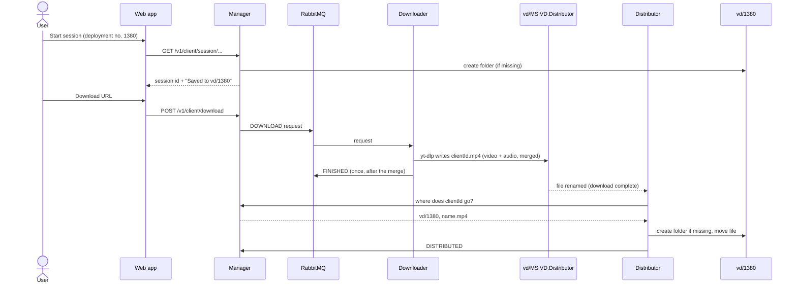
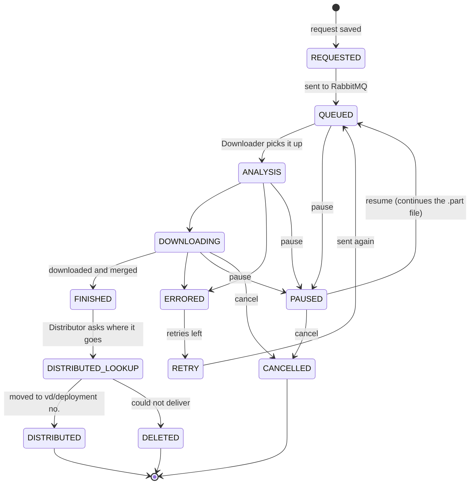
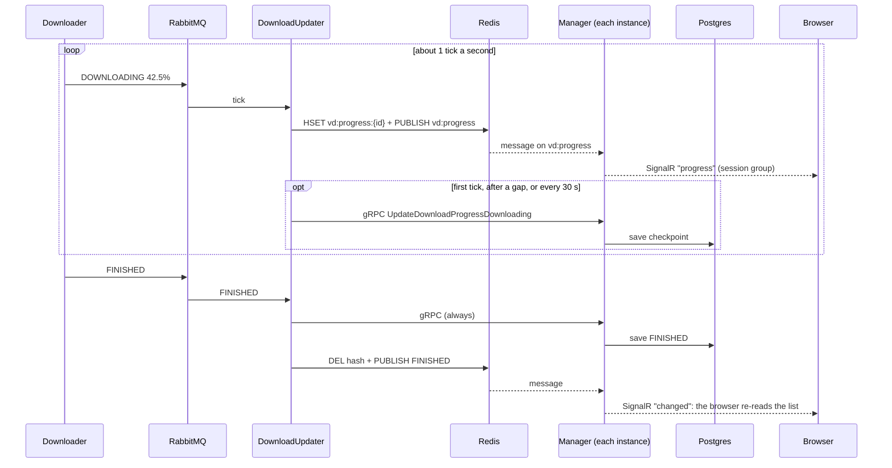

# MS.Video-downloader

A set of services for downloading videos with yt-dlp. Clients send download requests to the **Manager** gRPC API. The
Manager stores them in PostgreSQL and queues them on RabbitMQ. The **Downloader** picks them up and runs yt-dlp. The
**DownloadUpdater** sends progress back to the Manager, and writes every progress tick to **Redis**, from where the
Manager pushes it to browsers over SignalR. **Ytdlp** keeps yt-dlp up to date, and **Distributor** moves finished files
to their destination.

```mermaid
flowchart LR
    Web[React web app] -- REST --> Mgr[Manager]
    Web <-. SignalR live progress .- Mgr
    Mgr -- SQL --> PG[(Postgres: the record)]
    Mgr -- request / pause / cancel --> RMQ{{RabbitMQ: the work}}
    RMQ --> DL[Downloader yt-dlp]
    DL -- progress --> RMQ
    RMQ --> UPD[DownloadUpdater]
    UPD -- state changes + 30 s checkpoint, gRPC --> Mgr
    UPD -- every tick: HSET + PUBLISH --> R[(Redis: live, ephemeral)]
    R -- SUBSCRIBE --> Mgr
    DL -- writes file --> Share[/"vd/MS.VD.Distributor (share)"/]
    Share --> Dist[Distributor, Windows]
    Dist -- "where does it go? / delivered (gRPC)" --> Mgr
    Dist -- moves file --> Dep[/"vd/1380 (deployment no.)"/]
```

Messaging between services goes through RabbitMQ (MassTransit in the Manager). Postgres is the record. Redis holds only
live progress. Files travel through folders: the Downloader writes to the share folder, and the Distributor moves each
finished file to its deployment folder.

## Layout

| Folder | What | Tech |
| --- | --- | --- |
| `MS.Vid-dldr.Manager/` | gRPC API (+ JSON transcoding / Swagger), EF Core + PostgreSQL, MassTransit (RabbitMQ) sender | .NET 11 |
| `MS.Vid-dldr.Manager.Tests/` | xUnit tests for the Manager (sibling folder so the web SDK doesn't compile them into the API) | .NET 11 |
| `MS.Vid-dldr.Downloader/` | RabbitMQ consumer that runs yt-dlp | Python 3.12 |
| `MS.Vid-dldr.DownloadUpdater/` | Forwards download progress from RabbitMQ to the Manager over gRPC, and every tick to Redis | .NET 11 |
| `MS.Vid-dldr.DownloadUpdater.Tests/` | xUnit tests for the DownloadUpdater | .NET 11 |
| `MS.Vid-dldr.Ytdlp/` | Checks and reports yt-dlp versions via the Manager | .NET 11 |
| `MS.Vid-dldr.Ytdlp.Tests/` | xUnit tests for Ytdlp | .NET 11 |
| `MS.Vid-dldr.Distributor/` | Windows tool that distributes finished downloads | .NET 11 |
| `MS.Vid-dldr.Distributor.Tests/` | xUnit tests for the Distributor | .NET 11 |
| `docker-compose.{Dev,Prod,Test}.yaml` | Compose stacks; `.env.dev` / `.env.prod` hold queue names and paths | |
| `MS.Vid-dldr.Web/` | React + TypeScript front end (Vite, vitest), served by nginx in Docker | Node 24 |
| `observability/grafana/` | Grafana dashboard provisioning for the Dev compose's `otel-lgtm` (see Observability) | |
| `scripts/` | `Update-Ytdlp.ps1`, `Register-YtdlpUpdateTask.ps1` (see Keeping yt-dlp up to date), `Install-DistributorTask.ps1` (see Run) | PowerShell |

All services and their tests live in this one repository. Each service folder has its own `.sln`. The gRPC contracts
are the `Protos/ms_vdapi_*.proto` files, which are copied into each service; keep them in sync. The root `.gitignore`
covers build output (`bin/`, `obj/`), test results, `Logs/` and Python caches for every folder.

```sh
git clone https://github.com/michaeljohnkearney83/ms-video-downloader.git
```

Naming: folders, projects, `.sln` files, dlls and Docker images use `MS.Vid-dldr.*` / `ms-vid-dldr-*`. C# identifiers
can't contain `-`, so namespaces (and proto `csharp_namespace`) use `MS.Vid_dldr.*`, which matches the default root
namespace MSBuild derives from the project name. The compose project is `ms_vid-dldr`.

## Build

All .NET projects target `net11.0` and need the .NET 11 SDK (`winget install Microsoft.DotNet.SDK.11`). Without it,
build and test in the SDK image, which leaves your `bin/obj` alone:

```sh
docker run --rm -v "$PWD:/repo:ro" mcr.microsoft.com/dotnet/sdk:11.0 bash -c \
  'cp -r /repo /src && cd /src && dotnet test MS.Vid-dldr.Manager/MS.Vid-dldr.Manager.sln'
```

```sh
cd MS.Vid-dldr.Manager && dotnet build          # likewise for DownloadUpdater, Ytdlp, Distributor
cd MS.Vid-dldr.Web && npm ci && npm run build   # front end, to MS.Vid-dldr.Web/dist
```

## Test

```sh
dotnet test MS.Vid-dldr.Manager/MS.Vid-dldr.Manager.sln
dotnet test MS.Vid-dldr.DownloadUpdater/MS.Vid-dldr.DownloadUpdater.sln
dotnet test MS.Vid-dldr.Distributor/MS.Vid-dldr.Distributor.sln
dotnet test MS.Vid-dldr.Ytdlp/MS.Vid-dldr.Ytdlp.sln

cd MS.Vid-dldr.Downloader
python -m venv .venv && . .venv/bin/activate     # Windows: .venv\Scripts\activate
pip install -r requirements-dev.txt
python -m pytest

cd MS.Vid-dldr.Web
npm ci
npm test && npm run lint                          # vitest + Testing Library, oxlint
```

Each .NET test project sits next to its service and is in that service's `.sln`. They set `RollForward=Major`, so they
also run where only a newer .NET runtime is installed. `MoveFileTests.Locked_file_retry_logs_show_actual_values` relies
on Windows file locking and fails on Linux (it did before the .NET 11 upgrade too); run the Distributor tests on Windows. The Python tests are in `MS.Vid-dldr.Downloader/tests/`, outside
`app/`, so the Dockerfiles (which copy only `app/`) leave them out of the image.

### Manager

| Area | Covered |
| --- | --- |
| `StartupRetry` | success, retry then success, give up and rethrow, cancellation (in action, during delay, before start), invalid arguments |
| `UtilityHelper` | UTC now, JSON document formatting, proto "not set" timestamp, `RandomInt` range, `SetKind`, `GetMinWithKind` |
| `ServiceHelper.SetupMethod` | response with `Feedback.RequestJsonString`, null request error |
| AutoMapper profiles | `RequestDownloadRequest → Download`, `Download → DownloadRequestDto / AnalysisRequestDto`, `RequestExtractInfoFormatsRequest → ExtractInfo` |
| Hand-written mappers | `ConfigureVdMapper.Map` (download list, defaults for empty fields), `ClientVdMapper.Map` (formats, fragments, null formats) |
| MassTransit messaging | DOWNLOAD / ANALYSIS / EXTRACT_INFO / VERSION messages go through the real publisher on the in-memory transport and arrive as the same raw JSON as `DTO.ToString()` (nulls kept); queue address is non-durable |
| `RetryAnalysisDownloadAsync` | sends an ANALYSIS request marked `isRetry`; returns `false` when the send fails |
| Pause / resume / cancel | allowed transitions per status (queued or running: pause and cancel; paused: resume and cancel; finished or gone: nothing), the reason when not allowed, progress ignored only for PAUSED / CANCELLED, control message fields, `resume` flag on the request, control exchange is a non-durable fanout |
| Trace context on messages | a message sent inside a trace carries a W3C `traceparent` with the same trace id |
| Health checks | downloader check: busy worker is healthy with its sentence and job counts, stuck worker degraded with the reason, endpoint down degraded, no consumer returns the queue result without calling the endpoint, no URL = queue only; queue consumer check: healthy with a consumer, degraded with none (says how many messages wait), more than 10 consumers flagged as a leak, queue missing, management API down, statistics missing; database check timeout wording; every registered check gets a 3 s timeout; publisher records each check and overall and logs only changes; JSON report shape |

### DownloadUpdater

| Area | Covered |
| --- | --- |
| `ConfigureVdMapper.Map` | null DTO / null formats, defaults for empty fields, format values, fragments, downloader options, `HasDrm` → int |
| `DownloadUpdateDto` | deserialising the Python downloader's progress message, `activity` read as `dd/MM/yyyy` local time → UTC |
| `Telemetry.StartConsumeActivity` | continues the trace in a `traceparent` header (RabbitMQ's `byte[]` value), consumer kind and messaging tags; no header starts a new trace; missing headers read as empty |

### Distributor

| Area | Covered |
| --- | --- |
| `IgnoreFile` | GUID-named finished files pass; `.part`, `.m4a`, `.ytdlp`, `.json`, multi-dot, non-GUID, BBC / Facebook fragments and listed formats are ignored; missing format list |
| `MoveFileAsync` | move to the requested folder and name and report distributed; unknown client id; missing destination folder (share file deleted, reported deleted); failed distributed update; locked file (retry and delete-failure logs) |
| `AppSettings` | `FormatTypeWhitelist` keeps only `true` entries; missing section gives an empty list; `DistributorUsername` defaults to the Windows user, `"*"` kept |
| `Sanitise` | lower-casing and replacing unsafe characters |

### Ytdlp

| Area | Covered |
| --- | --- |
| `ParseVersion` | GitHub release span → `2025.01.15` (prefix and whitespace stripped); no prefix setting; changed markup / empty span / null page give `""` |
| `CheckVersionAsync` | posts `/v1/ytdlp/version/{version}`; no POST when no version is found or the page fails to load; Manager unreachable or returning 500 gives `false` without throwing |
| `AppSettings` | values read from configuration |

### Downloader (pytest)

| Area | Covered |
| --- | --- |
| `getValue` / `getProgressValue` | empty markers (`None`, `""`, `"None"`, `"N/A"`), real values kept, ANSI colour codes and whitespace stripped |
| `setGlobals` / `getYtdlpOptions` | request values; int defaults when the Manager's string values are null or empty; output template, retries, timeout |
| `loadAppSettings` | env strings converted (`IS_DEBUG_MODE=False` → `False`, port / retry / timeout → int); defaults without env |
| Stall detection | `hasDownloadStalled` timer and reset; `progressHooks` raises `DownloadCancelled` when stalled |
| `progressHooks` | DOWNLOADING update fields; one percentage across a video + audio download (`overall_progress.py`, weighted by part size); never FINISHED (`download()` sends that once, after the merge); ERRORED for unknown status |
| `on_message_received` | VERSION reply, routing to download / analyse / extract, unsupported type, empty body, ack |
| `analyse` / `extract` / `download` | with a fake `yt_dlp.YoutubeDL`: video details, live streams rejected, extract errors logged, formats sent, error code sent as text, cancelled download clears partial files |
| Helpers | `getDateDiff` (including whole days), `activity` date format, `getSoftwareVersion`, `printLog`, `serializeDatetime`, `clearCancelledFiles` |
| `control` | requests taken once, cleared, expired; control messages parsed or ignored; the stop exception is a yt-dlp `DownloadCancelled`; a progress hook stops a running download before sending progress; pause keeps the `.part` file and cancel deletes it, with no ERRORED update; a queued download that was stopped is skipped; a resume clears an old pause and continues the file; cancelling a paused download deletes its files unless it's running; pause never deletes |
| `health` (worker) | idle / busy / stuck (no progress past the threshold) / not consuming after start-up; progress keeps a long job healthy; success and failure counts with the last error; endpoint 200 / 503 / 404; watchdog reports the stuck job then exits, leaves progressing or idle jobs alone, off at 0; `main` records jobs, failures, progress, and doesn't count VERSION |
| `telemetry` | consumer span continues the Manager's trace (and gets the download id and message type); progress messages carry the same `traceparent`; an ERRORED update fails the span; no header starts a new trace; `traced` records exceptions; `bytes` header values |

The Downloader tests replace the RabbitMQ producer and yt-dlp with fakes.

The Distributor and Ytdlp tests replace the Manager's REST API with a fake `HttpMessageHandler`, and the Ytdlp tests feed
HTML instead of loading GitHub. Both services keep settings in static fields (and the Distributor tests capture console
output and use temporary folders), so parallel test runs are switched off in those projects. None of the tests need a
database, RabbitMQ or network.

## Run

Whole stack (from the repo root). Machine-specific values go in git-ignored local files first:

```sh
cp .env.dev.local.example .env.dev.local          # then set your share folder, default folder, Postgres port
docker compose --env-file .env.dev --env-file .env.dev.local -f docker-compose.Dev.yaml up --build -d --wait
```

| Local file (git-ignored) | Overrides | For |
| --- | --- | --- |
| `.env.dev.local` | `.env.dev`: `HOME_DRIVE_PATH` (Downloader share folder), `MANAGER_HOME_DRIVE_PATH` (default download folder), `POSTGRES_HOST_PORT` | the Docker stack; `scripts/Update-Ytdlp.ps1` adds it automatically |
| `MS.Vid-dldr.Distributor/appsettings.Local.json` | `DownloaderShareFilePath` (same folder as `HOME_DRIVE_PATH`), `DistributorUsername` (`"*"` on a single-user machine) | the Distributor on Windows |
| `MS.Vid-dldr.Manager/appsettings.Local.json` | any `AppSettings` value | the Manager with `dotnet run` (not copied into the image) |

The tracked files keep the upstream defaults (`C:\DevelopmentEnvironments\...`). Paths in `.env` files use forward
slashes: compose decodes backslash escapes there.

Grafana (traces, logs, metrics) is then at http://localhost:3000; see Observability.

Then run the Distributor on Windows (it is not in the compose stack). Install it once as a logon task, so it runs in
the background whenever you're logged on:

```powershell
./scripts/Install-DistributorTask.ps1              # publish to %LOCALAPPDATA%\ms-vid-dldr\Distributor, register, start
./scripts/Install-DistributorTask.ps1 -Unregister  # stop it and remove the task
```

The script publishes a windowless Debug build (Release would load `appsettings.Release.json`, the original production
servers) with your `appsettings.Local.json`, and registers task *ms-vid-dldr Distributor*: 1 minute after logon (so
Docker Desktop can start), no time limit, restarted if it fails, one instance. Re-run it after changing the
Distributor's code. Its logs are in Grafana (Loki, `service_name="ms-vid-dldr-distributor"`). Run it from your own
PowerShell: a sandboxed tool's writes to `%LOCALAPPDATA%` aren't visible to Task Scheduler. For a quick run from the
repo instead: `cd MS.Vid-dldr.Distributor; dotnet run`.

How a download reaches its folder:



1. Starting a session creates its **deployment folder**, `vd\<deployment no.>` (e.g. `C:\Users\<you>\Videos\vd\1380`).
2. The Downloader saves `<clientId>.<ext>` in the share folder `vd\MS.VD.Distributor`. The Dev compose mounts the `vd`
   folder (`MANAGER_HOME_DRIVE_PATH`) into the Downloader at `/home-drive` and sets `DOWNLOAD_FOLDER` to
   `/home-drive/MS.VD.Distributor` (`SHARE_FOLDER_NAME` renames it). It mounts `vd`, not the share folder itself: a
   mount of a folder that is later deleted stays broken ("Unable to create directory: File exists"), whereas a deleted
   share folder is simply made again by the next download, and by the Distributor (at start-up and every 30 s). The
   Distributor's `DownloaderShareFilePath` must be the same folder.
3. The Distributor sees the rename that ends the download, asks the Manager where the file goes, moves it to
   `<RequestedDownloadFolder>\<RequestedDownloadName>.<ext>` and marks the download DISTRIBUTED. Until then it stays
   FINISHED.
4. The Distributor sends a user name: `DistributorUsername`, by default the **Windows user it runs as**. The Manager
   only returns downloads whose session has that username, so in production (several users, one network share) each
   Distributor delivers only its own user's files, and a session started under another name stays in the share
   folder. On a single-user machine set `"DistributorUsername": "*"` in `appsettings.Local.json` to deliver everyone's
   downloads; the Manager allows `*` only when `AppSettings:AllowAnyUserDistribution` is true (the Dev compose sets
   it, production doesn't).
5. The file goes to the session's deployment folder: `AppSettings:HomeDrivePath` + deployment number
   (`MANAGER_HOME_DRIVE_PATH`, e.g. `C:\Users\<you>\Videos\vd\1380\`). The web app always uses it and shows it under
   the URL; it has no folder box (an API client can still send its own `requestedDownloadFolder`). The session creates
   the deployment folder: the
   Dev compose mounts `MANAGER_HOME_DRIVE_PATH` into the Manager at `/home-drive` (`AppSettings:HomeDriveMountPath`),
   and only plain folder names are created (no `..` or separators). Without that mount (production) the folder is
   made on delivery instead: the Distributor **creates** the requested folder when it is missing, and
   the share folder too (at start-up, in every build, and again if it is deleted while running). Only a folder it can't
   create (a relative path, no access, a path under a file) makes it delete the file and mark the download DELETED.

Manager only, locally:

- PostgreSQL: the Dev compose exposes it on `localhost:5433`. The connection string key is
  `ConnectionStrings:DownloadsDb` (database `MS.VdDownloader`).
- RabbitMQ on `localhost:5672` (`AppSettings:ChannelHostName` / `ChannelPortNumber`; `ChannelUsername` /
  `ChannelPassword` default to `guest`).
- `cd MS.Vid-dldr.Manager && dotnet run`. The project targets net11.0.
- In `Development`, Swagger UI and gRPC reflection are enabled.
- Health: `/health/live` and `/health/ready` (see Health checks).

## Pause, resume and cancel

A download's statuses (pause, resume and cancel are the user's arrows):



| Endpoint (POST, body `{}`) | Allowed when | Result |
| --- | --- | --- |
| `/v1/client/download/{clientId}/pause` | REQUESTED, QUEUED, ANALYSIS, DOWNLOADING, RETRY | **PAUSED**: the Downloader stops; the partial `.part` file is kept |
| `/v1/client/download/{clientId}/resume` | PAUSED | **QUEUED**: the download is sent again with `resume: true`; yt-dlp continues the `.part` file (HTTP Range) |
| `/v1/client/download/{clientId}/cancel` | the above, and PAUSED | **CANCELLED**: the Downloader stops; partial files are deleted |

Anything else returns the reason in `feedback.errorMessage` ("Only a paused download can be resumed; this one is
CANCELLED"). The web app shows Pause / Resume / Cancel buttons per row (Cancel asks first).

How it works:

- **The Manager owns the state.** It saves PAUSED / CANCELLED first, then tells the Downloader. Progress, finished and
  errored updates for a paused or cancelled download are ignored, so late messages can't undo it and no retry starts
  (`Helpers/DownloadActions.cs`).
- **Control messages** go out with MassTransit to the fanout exchange `ms_vd_x_downloadControl`
  (`AppSettings:ExchangeDownloadControl`): `{"messageType":"CONTROL","action":"PAUSE"|"CANCEL","managerId":..,"downloadId":..}`,
  with `traceparent`. Every Downloader binds its own temporary queue to it, so this works with several Downloaders.
- **The Downloader** listens on a background thread (`app/control.py`; the worker thread is inside yt-dlp) and records
  the request. A running download stops at its next progress hook (a yt-dlp `DownloadCancelled`, which yt-dlp lets
  through); a queued one is skipped when its message arrives; cancelling a paused download deletes its files from the
  listener. Stopped jobs send no ERRORED update and count as `jobsStopped` on `/health`. Requests expire after an
  hour, and a resume clears any old one.
- **Resume** turns off `overwrites` (which implies no-continue) and turns on `continuedl` for that job only; new
  downloads still start clean.

Tested on the running stack with a throttled test server: paused at 23%, resumed with a ranged request from byte
7,325,316, finished, distributed, and the 30 MB file was byte-for-byte identical to the source; cancel while
downloading and cancel after pause both removed the partial file and stayed CANCELLED.

Limitation: control messages reach only Downloaders that are running (their queues are temporary). If the Downloader is
down when you cancel, the Manager still shows CANCELLED and ignores its updates, but a download it picks up later may
still complete and be distributed.

## Live progress (Redis + SignalR)

RabbitMQ still carries the **work** (requests, progress messages, pause/cancel) and Postgres is still the **record**.
Redis only holds what is true *right now* about running downloads, and is allowed to lose it.



| Step | Who | What |
| --- | --- | --- |
| 1 | Downloader | sends each yt-dlp progress tick to `ms_vd_q_downloadUpdate`. A YouTube download is two parts (video, then audio, then a merge); the ticks carry one overall percentage, weighted by part size, and FINISHED is sent once, after the merge, so the bar runs 0-100% once and the Distributor never sees a half-made file |
| 2 | DownloadUpdater | writes the tick to the hash `vd:progress:{id}` (10 min TTL) and `PUBLISH`es it on `vd:progress` |
| 3 | DownloadUpdater | sends the Manager (Postgres) only state changes, the first tick, the first tick after a 10 s gap (a resume) and one tick per `AppSettings:ProgressCheckpointSeconds` (30). If Redis is down it sends every tick, as before |
| 4 | Manager | `RedisProgressRelay` subscribes to `vd:progress` and pushes `progress` / `changed` to the SignalR group of the download's session (`/hubs/downloads`, `JoinSession(sessionId)`) |
| 5 | Manager | `GetDownloadsBySessionId` overlays the Redis percent on running downloads; a PAUSED/CANCELLED/FINISHED/ERRORED saved in Postgres always wins |
| 6 | Web | `DownloadList` updates the row in place on `progress`, re-reads on `changed`, and polls every 30 s while live (every 3 s when not). A green dot shows it is live. Finished downloads show 100% (the Manager clears the percentage then) |

Every Manager instance subscribes to the channel and pushes to its own connections, so there is deliberately **no
SignalR Redis backplane**: with one, each event would reach the browser once per instance.

Measured on the Dev stack (30 MB file throttled to 300 KB/s, 107 s): 112 pushes over a WebSocket, the list matched the
latest push at 45 s, and the `Downloads` table took **9 row updates instead of about 115**. Metrics:
`vd.updater.progress.skipped` (ticks kept out of Postgres) and `vd.live.pushes` (by `vd.live.kind`).

nginx (`/hubs/` with the WebSocket upgrade headers) and the Vite dev proxy (`ws: true`) forward the hub, so the browser
stays same-origin. Settings: `ConnectionStrings:Redis` for the Manager and DownloadUpdater (default
`redis:6379,abortConnect=false` in the Updater, `localhost:6379` for a `dotnet run` Manager). The Prod and Test compose
files have no Redis yet; the services start without it and behave as before.

## Health checks

The Manager answers two questions (ASP.NET Core health checks, `MS.Vid-dldr.Manager/Health`):

| Endpoint | Question | Checks | Used by |
| --- | --- | --- | --- |
| `/health/live` | Is the process running? | none | Docker `healthcheck` (restart decisions, `depends_on`) |
| `/health/ready` | Can it do its job? | `database` (Postgres), `masstransit-bus` (RabbitMQ, added by MassTransit), `downloader` (a consumer on its queue, then the Downloader's own `/health`), `updater` (a consumer on its queue, from the RabbitMQ management API), `redis` (PING) | the web app's status badge, `IsServiceUp`, the `vd.health.status` metric and the Grafana alert |

`/health/ready` returns JSON (`status`, then `name`, `status`, `description`, `durationMs`, `data` for each check) with
HTTP 200 for Healthy or Degraded and 503 for Unhealthy:

- **Unhealthy:** Postgres or RabbitMQ is down. The Manager can't take requests.
- **Degraded:** no Downloader or DownloadUpdater is consuming its queue ("No Downloader is consuming
  ms_vd_q_downloadRequest (4 message(s) waiting)"). Requests are still accepted; they wait in the queue. More than 10
  consumers on a queue is also Degraded ("possible consumer leak"), which would have caught the DownloadUpdater's
  258,283 consumers. A Downloader that is connected but stuck is Degraded too (see below). Redis being down is
  Degraded as well: downloads carry on, the list falls back to polling and Postgres gets every tick again.

### The Downloader's own health

A consumer on the queue only proves the Downloader is connected. It can be connected and still hung (a stalled site,
ffmpeg), so the Python Downloader reports what it is doing itself (`app/observability/health.py`):

- **`GET http://downloader:8081/health`** (`HEALTH_PORT`; inside the Docker network, not published) returns
  `status`, a sentence (`"Idle, waiting for requests"`, `"Busy for 3m on DOWNLOAD 42 (last progress 5s ago)"`), the
  current job, jobs succeeded / failed, the last failure, and the yt-dlp version. HTTP 503 when Unhealthy.
- **Unhealthy** when it isn't consuming the queue (after 30 s of start-up), or a job has shown no progress for
  `HEALTH_STUCK_AFTER_SECONDS` (600). Progress is any yt-dlp progress hook, so a long download that keeps moving stays
  Healthy.
- **Watchdog:** after `HEALTH_EXIT_AFTER_SECONDS` (900; 0 = off) without progress, it sends the Manager an ERRORED
  update for the job ("Downloader restarted: no progress for 15m"), so the Manager's retry takes over, then exits.
  Docker restarts containers that exit, not ones that are merely unhealthy, so the worker does it itself.
- The endpoint and the watchdog run on their own threads: the worker is single-threaded (pika `BlockingConnection`,
  one message at a time) and can't answer while a download runs.

The Manager's `downloader` check counts consumers first, then (when `AppSettings:DownloaderHealthUrl` is set; the Dev
compose sets `http://downloader:8081/health`) asks the Downloader and reports its sentence: Degraded with
"Stuck: DOWNLOAD 15 has shown no progress for 11m", or "... but its health endpoint doesn't answer". The Downloader's
Docker healthcheck calls the same endpoint.

Liveness has no dependency checks on purpose: a Postgres outage shouldn't make Docker restart a Manager that is fine.
Every check has a **3 s timeout**. Without it the database check ran EF's retry-on-failure strategy and `/health/ready`
took 66 s to answer 503 when Postgres was down; now it answers in 3 s ("No answer from Postgres within 3 s").

`IsServiceUp` (`/v1/generic/isServiceUp/...`) used to return `isUp = 1` unconditionally. It now runs the ready checks:
`isUp` is 0 when they are Unhealthy, and the warning message lists any check that isn't healthy.

In the background the same checks run every 15 s. `HealthMetricsPublisher` exports them as the gauge
`vd.health.status` (2 Healthy, 1 Degraded, 0 Unhealthy, label `vd.health.check` plus `overall`) and logs each change
once ("Health check downloader is Degraded (was Healthy): ..."), as a warning or an error, so changes reach Loki and
Sentry. The framework's own per-run log is turned down (`Microsoft.Extensions.Diagnostics.HealthChecks`: Critical)
because it repeated every 15 s.

Settings: `AppSettings:ChannelManagementPort` (default 15672), `AppSettings:QueueDownloadUpdate` (default
`ms_vd_q_downloadUpdate`), `AppSettings:DownloaderHealthUrl` (empty = queue check only, e.g. a Manager run with
`dotnet run` outside Docker); the management API uses `ChannelUsername` / `ChannelPassword`.

**Docker.** The Dev compose has healthchecks for Postgres (`pg_isready`), RabbitMQ (`rabbitmq-diagnostics ping`),
the Manager (`/health/live`, sent with bash's `/dev/tcp` because the aspnet image has no curl), the Downloader (its
`/health`, with Python's urllib) and the web app (nginx `/healthz`). Services wait for
`service_healthy` dependencies: the Manager for Postgres and RabbitMQ; the Downloader, DownloadUpdater and Ytdlp for the
Manager. `docker compose ... up -d --wait` returns once everything is healthy. The Manager's start-up migration retry
stays, for stacks without healthchecks.

**Grafana.** The dashboard's top panel is a health timeline per check. The alert rule *Video downloader dependency not
healthy* (`observability/grafana/alerting.yaml`) fires when any check is below Healthy for 2 minutes, or when there is no
data (the Manager isn't reporting). A second rule, *Video downloader jobs mostly failing*, catches "up but failing":
more than half of the download / analyse / extract jobs ended in ERRORED over 15 minutes (at least 3 jobs, for 5
minutes); usually a site changed and yt-dlp needs updating. The dashboard plots that share with the 50% line. Alerts
show under Alerting; add a contact point (email, Slack, Teams) to be notified.

Tested on the running stack: stopping the Downloader gave Degraded (HTTP 200, the web app showed "! Downloader" with
the reason, the Manager stayed live, the alert fired after 2 minutes); stopping Postgres gave Unhealthy (HTTP 503 in
3 s, `isUp = 0`, the web app showed "Down ✕ Database"); both recovered when the container started again. A download
from an unroutable address with short test thresholds showed "Stuck: DOWNLOAD 15 has shown no progress for 11s"
(Degraded); with the watchdog at 12 s the Downloader reported "Downloader restarted: no progress for 18s", exited, and
Docker restarted it, and the Manager queued the retry. The failures from that testing (70%) fired the error-rate alert.

## Observability

Every service sends **traces, metrics and logs** with OpenTelemetry (OTLP) to `otel-lgtm` in the Dev compose: an
OpenTelemetry collector with Tempo (traces), Loki (logs), Prometheus (metrics) and Grafana. Errors can also go to
**Sentry**.

| | |
| --- | --- |
| Grafana | http://localhost:3000 (admin / admin). Dashboard: *Video downloader → Video downloader - overview*. Explore has Tempo, Loki and Prometheus. |
| OTLP | `otel-lgtm:4317` (gRPC, .NET) and `:4318` (HTTP, Python); from the host, `localhost:4317` (the Distributor's default) |
| Settings | `OTEL_EXPORTER_OTLP_ENDPOINT`, `OTEL_SERVICE_NAME`, `OTEL_METRIC_EXPORT_INTERVAL` (15000 in Dev); `SENTRY_DSN` turns Sentry on (empty = off) |
| Code | `Observability/Telemetry.cs` (Manager, DownloadUpdater, Ytdlp, Distributor), `app/observability/telemetry.py` (Downloader) |

### Correlation ids

- **The W3C trace id is the correlation id.** The web app starts a trace (`traceparent` on every API call). The Manager
  continues it and returns it in `X-Trace-Id`, and the web app shows it with errors ("… (trace 5071…)").
- The trace crosses RabbitMQ in both directions: the Manager's MassTransit sender adds `traceparent` to each request
  message; the Python Downloader continues it in a consumer span and adds its own `traceparent` to every progress message;
  the DownloadUpdater (RabbitMQ.Client 6 has no instrumentation, so `Telemetry.StartConsumeActivity` does it by hand)
  continues it, and its gRPC call to the Manager carries it back. One download is one trace:
  `web → Manager → Postgres → RabbitMQ → Downloader (yt-dlp) → RabbitMQ → DownloadUpdater → Manager`, retries included.
- **Business ids** go on spans and logs too: `vd.download.id` (Manager database id) and `vd.download.client_id` (the GUID,
  also the downloaded file's name). The Distributor finds files through the file system, which carries no trace context,
  so its `distribute file` span starts a new trace; search Tempo for `{ span.vd.download.client_id = "<guid>" }` to join
  the two.
- Every log line (Loki) has `trace_id` and `span_id`; Grafana links a log line to its trace and a trace to its logs.

### Structured logs (Loki)

.NET services log through `ILogger` with message templates (`Download {DownloadId} ({ClientId}) queued for
{RequestedUrl}`), so each property is a field in Loki, not just text. The older `WriteLog(status, line)` calls in Ytdlp and
the Distributor, and `printLog` in the Downloader, are routed to the same pipeline with a level. Noisy loggers are turned
down: EF Core's SQL command log (the Postgres spans already show each query) and pika's per-connection logs.

There is one logging pipeline: `ILogger` → OpenTelemetry → Loki (plus the console, for `docker logs`). The Manager used
to add Serilog as well, and it was removed: its file sink used a Windows path from the original developer's machine that became a
growing file *named* that path inside the Linux container; the static `Log.Information` / `Log.Error` calls went nowhere
because Serilog's static logger was never configured; and the Release config's HTTP sink to Logstash never loaded
(`Serilog.Sinks.Http` wasn't referenced). To ship logs elsewhere in production (ELK, a hosted service), point
`OTEL_EXPORTER_OTLP_ENDPOINT` at an OpenTelemetry collector and export from there.

Useful LogQL: `{service_name=~"ms-vid-dldr.+"} | detected_level="error"` and
`{service_name=~"ms-vid-dldr.+"} | trace_id="<trace id>"`.

### Metrics and dashboard (Prometheus, Grafana)

Built in: ASP.NET Core / gRPC server, HttpClient, .NET runtime, Npgsql, MassTransit. Custom:

| Metric | Service | Labels |
| --- | --- | --- |
| `vd.downloads.requested` | Manager | |
| `vd.download.status_updates` | Manager | `vd.download.status` |
| `vd.updater.messages`, `vd.updater.processing.duration` (s) | DownloadUpdater | `vd.download.status` |
| `vd.downloader.messages`, `vd.downloader.errors` | Downloader | `vd.message_type` |

`observability/grafana/dashboards/ms-vid-dldr.json` is generated by `observability/grafana/make_dashboard.py` (edit the
script, run `python observability/grafana/make_dashboard.py`, commit both) and provisioned into Grafana: headline numbers, Manager rate and p95
by route, status updates, Downloader messages, Updater and Postgres latency, error logs from Loki and failed traces from
Tempo. otel-lgtm also ships RED dashboards built from spans. Prometheus runs with `created-timestamp-zero-ingestion`, so a
new counter's first events count in `increase()`; the services also report their counters at 0 at start-up.

### Sentry

Set `SENTRY_DSN` (in the shell or `.env.dev`) to send errors: the Manager uses `Sentry.AspNetCore` (unhandled exceptions
and error logs), the workers send `ILogger` errors, and the Downloader uses `sentry-sdk`. Tracing stays in
OpenTelemetry; each Sentry event is tagged `otel.trace_id` so you can jump from the error to the whole trace.

### Debugging a slow request across five services

1. **Get the trace id.** From the web app's error text, the `X-Trace-Id` response header, a Sentry event's
   `otel.trace_id` tag, or the dashboard's *Failed traces* table. No id? Search Tempo:
   `{ resource.service.name = "ms-vid-dldr-manager" && duration > 2s }`, or by business id:
   `{ span.vd.download.client_id = "<guid>" }`.
2. **Open the trace in Tempo.** The waterfall shows where the time goes: HTTP handler, each Postgres query, the
   MassTransit send, the wait in RabbitMQ (gap before the Downloader's `process` span), `yt-dlp analyse` / `download`,
   the Updater's forward and the Manager's gRPC handler. Failed spans are red, with the exception attached.
3. **Read the logs for that trace.** In the span, *Logs for this span*, or LogQL `| trace_id="<id>"`: every service's lines
   for this request only.
4. **Check whether it's one request or all of them.** On the dashboard, p95 by route and the Postgres / Updater latency
   panels show whether the slow span is a trend. A sudden change at a deploy points at the release (`service.version`
   is on every signal).
5. **Find the cause, fix it, and confirm on the same panels.**

What this setup found here:

- **DownloadUpdater consumer leak.** `StartAsync` registered consumers in a `while (!cancellationToken...)` loop that
  never ended: 258,283 consumers on `ms_vd_q_downloadUpdate`, RabbitMQ at ~190% CPU and the Updater at 1.6 GB. It now
  registers one consumer (28 MB).
- **Timeouts that never fired.** `RequestExtractInfoFormats` and `GetCollectiveVersions` used `TimeSpan.Milliseconds`
  (the 0-999 part) instead of `TotalMilliseconds`, so a failed extraction kept the request polling Postgres in a tight
  loop. It now times out (3 s) and waits 100 ms between polls.
- **Retries are visible.** A failing download shows as one trace with the Manager's ERRORED → RETRY → resend loop.

Health status is a metric too (`vd.health.status`, see Health checks), with an alert rule on it.

Not covered yet: RabbitMQ broker metrics (queue depth, unacked messages; enable the `rabbitmq_prometheus` plugin) and
browser-side spans (the web app sends `traceparent` but exports no spans, so Tempo shows the root as "not yet received").

## CI

`.github/workflows/ci.yml` runs on pushes to `main`, on pull requests and on demand:

| Job | What |
| --- | --- |
| .NET (matrix) | `dotnet test` for the Manager, DownloadUpdater and Ytdlp on Linux, and the Distributor on Windows (its locked-file test needs Windows file locking); test results uploaded as artifacts |
| Downloader | `pytest` on Python 3.12 |
| Web | `npm ci`, lint, test, build |
| Docker images | builds every image in the Dev compose, after the test jobs pass (no push) |

## Messaging (MassTransit)

The Manager sends work to the Downloader with [MassTransit](https://masstransit.io) 8 over RabbitMQ
(`MS.Vid-dldr.Manager/Messaging`). Services depend on `IDownloadRequestPublisher`; `MassTransitDownloadRequestPublisher`
sends each DTO to `AppSettings:QueueRequestDownload` (`ms_vd_q_downloadRequest`).

The Python Downloader still reads that queue with pika, so:

- Messages are sent with MassTransit's **raw JSON** serializer, not its envelope. The body is the DTO with its
  `[JsonPropertyName]`s and nulls kept, the same JSON the old `RabbitMQ.Client` producer sent. MassTransit adds `MT-*`
  headers, which pika ignores.
- The queue address is `queue:ms_vd_q_downloadRequest?durable=false`, because pika declares the queue non-durable and
  RabbitMQ rejects a declaration with different arguments. MassTransit also declares a non-durable fanout exchange of the
  same name bound to the queue.
- The startup VERSION request is sent once the host has started (`ApplicationStarted`), after the bus is running.

MassTransit is pinned to 8.x: v9 needs a commercial licence. The DownloadUpdater and the Python services still use their
own RabbitMQ clients.

## .NET 11 upgrade notes

- Packages moved to their 11.x / latest versions (EF Core, Npgsql, gRPC, Microsoft.Extensions.*). Package
  references that .NET 11 already provides were removed (NU1510).
- Held back: **MassTransit 8.5** and **AutoMapper DI 12.0.1** (newer majors need a commercial licence), and
  **RabbitMQ.Client 6.5** in the DownloadUpdater (7.x is an async rewrite). NuGet reports high-severity advisories for
  AutoMapper 12.0.1 (NU1903).
- Ytdlp uses `HtmlAgilityPack.CssSelectors.NetCore` instead of the old `HtmlAgilityPack.CssSelectors`, whose
  HtmlAgilityPack 1.4.9 dependency fails .NET 11's stricter zip check during restore.
- Dockerfiles use the `11.0` / `11.0-alpine` images and publish to `out/`, so the path no longer names the framework.
  The .NET 8+ images already have a non-root `app` user; the DownloadUpdater uses it. The Manager's alpine image is now
  `aspnet` (it was `runtime`, which can't run ASP.NET Core).
- The Dev compose pins `postgres:17`. `latest` is 18+, which refuses the `/var/lib/postgresql/data` volume mount.

## Front end

`MS.Vid-dldr.Web` is a React app for the Manager's REST API: session, download request, formats, live progress, and a
status badge from `/health/ready`. In the Dev compose it is the `web` service on http://localhost:8080 (nginx serving
the build and proxying `/v1` and `/health` to the Manager). For development, `npm run dev` in that folder proxies to a
Manager on `localhost:8000`. See `MS.Vid-dldr.Web/README.md`.

- **Formats:** "Check formats" lists what yt-dlp found; Hide formats / Show formats collapses the table.
- **Clear distributed (n):** hides delivered downloads from the list. It only hides them in this browser
  (`localStorage`, per session); the Manager keeps the records for history, the dashboard and the Distributor.

## Resilience

| What | Where | Setting |
| --- | --- | --- |
| Start-up order | Dev compose `depends_on: condition: service_healthy` | Postgres and RabbitMQ healthy before the Manager starts; the workers wait for the Manager's liveness |
| Startup migration retry | Manager `Program.cs` → `Helpers/StartupRetry.cs` | `AppSettings:StartupDbRetryCount` attempts (default 10), 5 s apart; covers stacks without healthchecks |
| Health check timeouts | Manager `Health/HealthSetup.cs` | 3 s per check, so a dead dependency reports Unhealthy quickly instead of retrying |
| DB transient-failure retry | Manager `AddDbContext` → Npgsql `EnableRetryOnFailure` | 5 retries, max 10 s delay |
| Outbound HTTP | Ytdlp / Distributor `AddHttpClient("ms-vid-dldr-httpClient").AddResilienceHandler(...)` | existing retry pipelines |

With `EnableRetryOnFailure`, any explicit transaction (`BeginTransaction`, `TransactionScope`) must run inside
`dbContext.Database.CreateExecutionStrategy().ExecuteAsync(...)`, or EF throws at runtime. There are none today.

## Docker

The Dockerfiles call `dotnet restore/publish MS.Vid-dldr.<Service>.csproj` explicitly, because each folder also contains a
`.sln` (a plain `dotnet publish` fails with MSB1011, and the Manager solution references the test project, which is
outside the build context).

## Keeping yt-dlp up to date

Sites change often, so yt-dlp needs regular updates. Docker caches the Downloader's `pip install` layer, so
`docker compose up --build` keeps whatever yt-dlp it installed first. Instead, the Downloader Dockerfiles take a
`YTDLP_VERSION` build argument (the Dev compose passes `${YTDLP_VERSION}` through), and a new value rebuilds only that
layer.

`scripts/Update-Ytdlp.ps1` (Windows PowerShell 5.1 or PowerShell 7, from anywhere):

1. reads the latest yt-dlp from PyPI and the version in the running `downloader` container;
2. if PyPI is newer, asks the Manager (`/v1/configure/downloads/take/200`) for downloads in ANALYSIS or DOWNLOADING with
   activity in the last 30 minutes. The Downloader acks a message as soon as it receives it, so a restart would lose
   such a download: the script skips the run and the next one tries again;
3. rebuilds the image with `YTDLP_VERSION=<latest>`, restarts only that container (`--no-deps`) and checks the version.

```powershell
./scripts/Update-Ytdlp.ps1 -WhatIf                       # report only
./scripts/Update-Ytdlp.ps1                               # update if newer
./scripts/Update-Ytdlp.ps1 -Version 2026.10.21 -Force    # install a specific release (e.g. roll back)
./scripts/Register-YtdlpUpdateTask.ps1                   # run it daily at 04:00 (Task Scheduler, current user)
./scripts/Register-YtdlpUpdateTask.ps1 -Unregister
```

Other parameters: `-ComposeFile` (several allowed, in `-f` order), `-EnvFile`, `-ManagerUrl`, `-BusyWindowMinutes`,
`-SkipBusyCheck`. Each run appends to `Logs/Update-Ytdlp.log` (git-ignored); exit code 0 means up to date, updated or
skipped, and 1 means it failed. If the Downloader isn't running, the script only rebuilds the image.

This applies to the Dev stack, which builds its images locally. The Prod compose pulls a published Downloader image, so
rebuild and push that image instead.
